    <picture>
        <source media="(prefers-color-scheme: dark)" srcset="/assets/logo_gh_dark.webp"/>
        <source media="(prefers-color-scheme: light)" srcset="/assets/logo_gh_light.webp"/>
        
    </picture>

 

<b>Absolute Johannes factotum</b>

    

    <dl align="justify">
        <dt>
            <a href="http://scp-wiki.wikidot.com/scp-8459" title="Yes, that SCP Foundation.">SCP-8459</a>
            <mark>(?)</mark>
        </dt>
        <dd>SCP-8459 is a collection of old online videos that first appeared in early 2000, right after the Y2K computer scare. These videos show a version of reality where the SCP Foundation, a secret organization, is publicly known and even has merchandise or is part of everyday life, like a government agency or a popular franchise. The videos have incredibly advanced visuals for their time, far beyond what was technologically possible in 2000, and include details like Princess Diana being a world president or Foundation sites in orbit. The Foundation contains these videos by monitoring online platforms, spreading misinformation to discourage people from sharing them, and keeping copies on isolated servers for study, believing they might be digital glimpses from alternate timelines that briefly merged with ours during the Y2K event.</dd>
        <dt>
            <a href="https://en.wikipedia.org/wiki/Skoptsy">Skoptsy</a>
            <mark>(?)</mark>
        </dt>
        <dd>The Skoptsy were a Spiritual Christian sect within Eastern Orthodoxy, primarily known for their practice of emasculation in men and mastectomy and female genital mutilation in women. They believed that original sin entered the world through sexual intercourse and that human genitals were the "mark of Cain," advocating castration as a path to salvation and interpreting biblical passages to support their views. The sect emerged in the late 18th century, worshipping their founder, Kondraty Selivanov, as the second Christ, and believed he would return to initiate a thousand-year reign once 144,000 people had been castrated. Despite severe persecution by the Russian state and later by the Soviet Union, the Skoptsy grew significantly, even attracting members from various social classes, before their numbers drastically declined due to repression and collectivization.</dd>
    </dl>

